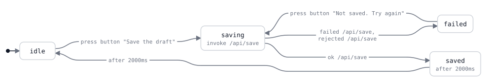

# silica

> [!WARNING]
> silica is experimental.

**Statechart-driven UI in OCaml**

silica is a view framework for OCaml where all behaviour lives in statecharts, with a model checker built in. A component is a machine and a view, so silica can explore every state that the component can reach and verify its properties, with no browser and before a user finds the bug.

- State machines handle all the possible states, so they can be verified without running, replayed, debugged and run everywhere.
- The silica code runs on the server as native OCaml and in the browser as JavaScript, thanks to [Melange](https://melange.re).
- Data can live on the client (local state), on the server (remote data) or live (a WebSocket, experimental).
- It comes with a typed router: the routes are the states of a machine, and one value reads and writes each URL. It has guards, preload, unsaved-changes blocks and lazy routes.
- All browser actions and states are represented as state machines as well.
- Machines can compose.

## Example

A button that saves a draft: it calls the server, shows the time of the save for two seconds, and goes back to idle.

```ocaml
open Silica

let save = (* assume a Api.save http request call here of your fav client *)

(* The events of the machine. *)
type event = Save | Answer of (string, string) Remote.answer | Reset

(* The states. [Saved] carries the time of the save. *)
type state = Idle | Saving | Saved of string | Failed

(* The state names, used by the checker, the traces and the diagrams. *)
let name = function
  | Idle -> "idle"
  | Saving -> "saving"
  | Saved _ -> "saved"
  | Failed -> "failed"

let machine =
  Machine.make ~id:"save" ~init:Idle ~name
    (* What runs in each state. The call runs while the machine is in
       [Saving], and the timer while it is in [Saved]. Leaving the state
       stops them. *)
    ~during:(function
      | Saving -> [ Remote.call save "draft" (fun answer -> Answer answer) ]
      | Saved _ -> [ Source.after 2000 Reset ]
      | Idle | Failed -> [])
    (* The transitions. [Saving] ignores [Save], so a double click sends
       one request. *)
    (fun state event ->
      match (state, event) with
      | (Idle | Failed), Save -> Go Saving
      | Saving, Answer (Ok time) -> Go (Saved time)
      | Saving, Answer (Rejected _ | Failed _) -> Go Failed
      | Saved _, Reset -> Go Idle
      | _ -> Ignore)

(* The view of each state. [on_press] takes an event value, so the
   checker can list the events of a view. *)
let view (state : state) : event Node.t =
  <div>
    (match state with
     | Idle -> <button on_press=Save>"Save the draft"</button>
     | Saving -> <button disabled=true>"Saving"</button>
     | Saved time -> <p>(Node.text ("Saved at " ^ time))</p>
     | Failed -> <button on_press=Save>"Not saved. Try again"</button>)
  </div>

let demo = Component.make machine view
```

silica draws the statechart of this component from the code:

<picture>
  <source media="(prefers-color-scheme: dark)" srcset="docs/readme/save-dark.svg">
  
</picture>

## What this makes possible

Every state of the app is encoded, so silica can be more than a view framework:

- **A contract for AI agents**: an agent writes the machine, the model checker judges it, and you review the statechart diff, not the code.
- **An app that agents can use**: silica can expose the events of a machine and the routes of the router as MCP tools, so an agent uses the app through its states and not through the screen.
- **Design conformance**: check that the code follows the statechart of a design or a spec.
- **Client and server monitoring**: a transition that the spec does not allow is an alert, and a funnel is a path in the graph.
- **Whole-app diagrams**: the statechart of every component and route, drawn from the code, so it is never out of date.
- **Tests from the graph**: every path is a test, and every reachable state is a story and a screenshot.

## License

MIT © [David Sancho](https://github.com/davesnx)
